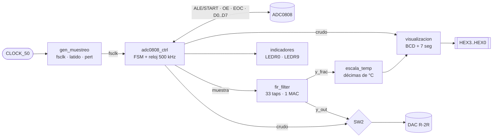
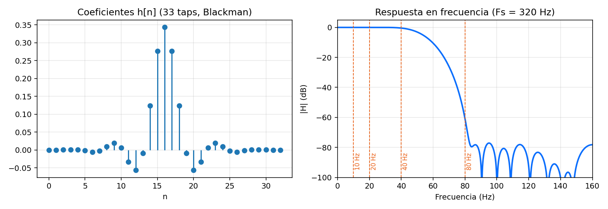

<div align="center">

# 🎛️ Filtro FIR digital en FPGA con ADC0808

**Adquisición, filtrado pasa-bajas y visualización de una señal analógica sobre la DE1 (Cyclone II), escrito en VHDL.**


</div>

---

## ✨ ¿Qué hace?

El sistema muestrea una señal analógica con un **ADC0808** a **320 Hz**, la filtra con un **FIR pasa-bajas de 33 coeficientes** (ventana Blackman, Fc = 55 Hz) implementado con **un solo multiplicador**, y entrega el resultado de dos formas:

- 🔢 **Displays de 7 segmentos**: temperatura en décimas de °C (ej. `C 24.9`) o código crudo del ADC.
- 📈 **DAC R‑2R de 8 bits**: señal cruda o filtrada, seleccionable, para verla en el osciloscopio.

Además incluye un **generador de perturbación** (onda cuadrada sincronizada con el muestreo, `f = Fs/r` con r = 4, 8, 16, 32) para comprobar el efecto del filtro.

## 🧩 Arquitectura



| Módulo | Función |
|---|---|
| [`lab2_top`](src/lab2_top.vhd) | Nivel superior: instancias, inversión de `KEY0`, mux de derivación (`SW2`) y asignación de GPIO. |
| [`gen_muestreo`](src/gen_muestreo.vhd) | Un único contador genera `fsclk` (320 Hz), `latido` (Fs/2) y `pert` (Fs/r). `pert` conmuta medio periodo antes de cada muestreo. |
| [`adc0808_ctrl`](src/adc0808_ctrl.vhd) | Reloj de 500 kHz y FSM: `START/ALE → espera EOC bajo → espera EOC alto → OE → lectura`. Incluye sincronizador de EOC y *timeout*. |
| [`fir_filter`](src/fir_filter.vhd) | FIR serie con un multiplicador, 35 ciclos por muestra, saturación y 4 bits fraccionarios. |
| [`escala_temp`](src/escala_temp.vhd) | Convierte la salida del FIR a décimas de grado (`K = 2209`, `SH = 14`); refresco a 4 Hz. |
| [`bin_a_bcd`](src/bin_a_bcd.vhd) | Doble‑dabble combinacional (3 dígitos). |
| [`hex7seg`](src/hex7seg.vhd) | Decodificador 7 segmentos (activo en bajo). |
| [`visualizacion`](src/visualizacion.vhd) | Elige entre temperatura y código crudo (`SW3`). |
| [`indicadores`](src/indicadores.vhd) | `LEDR0` parpadea a 1 Hz; `LEDR9` indica saturación (código 0 o 255). |

## 📉 El filtro



Con Fs = 320 Hz, la ganancia calculada a partir de los coeficientes es:

| Frecuencia | Ganancia | `SW[1:0]` (perturbación) |
|---:|---:|:---:|
| 10 Hz | 0 dB | `11` (r = 32) |
| 20 Hz | 0 dB | `10` (r = 16) |
| 30 Hz | ≈ 0 dB (banda de paso) | — |
| 40 Hz | −0,4 dB | `01` (r = 8) |
| 55 Hz | −6 dB (Fc) | — |
| 80 Hz | −61 dB | `00` (r = 4) |

La suma de coeficientes es 2¹⁵ ⇒ **ganancia en DC = 1**.

## 🎚️ Controles de la placa

| Control | Función |
|---|---|
| `KEY0` | Reset (activo en bajo) |
| `SW[1:0]` | Frecuencia de la perturbación: `00` → Fs/4 · `01` → Fs/8 · `10` → Fs/16 · `11` → Fs/32 |
| `SW2` | DAC: `0` señal cruda · `1` señal filtrada |
| `SW3` | Display: `0` temperatura (°C) · `1` código crudo del ADC |
| `LEDR0` | Parpadeo 1 Hz = hay muestreo |
| `LEDR9` | Saturación del ADC |

## 🔌 Conexiones (GPIO_0)

| GPIO_0 | Señal | GPIO_0 | Señal |
|:--:|---|:--:|---|
| 0 | `pert` | 14…7 | ADC `D7…D0` (entrada) |
| 1 | `latido` | 15 | libre |
| 2 | `ADC_CLK` (500 kHz) | 23…16 | DAC R‑2R, bit 7…0 |
| 3 | `ALE` | | |
| 4 | `START` (misma señal que ALE) | | |
| 5 | `OE` | | |
| 6 | `EOC` (entrada) | | |

> Las entradas `ADD A, B, C` del ADC0808 van a GND (canal IN0). Alimentar el ADC0808 y referenciarlo a 5 V.

## 🚀 Cómo usarlo

### Opción rápida — programar el bitstream
1. Conecta la DE1 por USB‑Blaster.
2. En Quartus **Tools → Programmer**, carga [`bitstream/lab2_top.sof`](bitstream/lab2_top.sof) y pulsa *Start*.

### Compilar desde cero
1. Abre `quartus/lab2_top.qpf` en **Quartus II 13.0 SP1** (o equivalente que soporte Cyclone II).
2. **Processing → Start Compilation**.
3. Programa el `.sof` generado en `quartus/output_files/`.

> 📌 Las rutas del proyecto apuntan a `../src/` y se incluye `constraints/lab2_top.sdc` con el reloj de 50 MHz.

### Simulación (GHDL)
```bash
sudo apt install ghdl
make sim          # o ./sim/run_sim.sh
```

| Testbench | Qué verifica |
|---|---|
| `tb_gen_muestreo` | Periodo exacto de `fsclk`, desfase de medio periodo de `pert` y las 4 posiciones del selector (incluye cambios en pleno conteo). |
| `tb_adc0808` | Secuencia completa con un modelo simple del ADC; la muestra recibida es la esperada. |
| `tb_fir` | Ganancia DC = 1 (entrada 100 → salida 100) y respuesta al impulso (pico = 880 con 4 bits fraccionarios). |

Los tres pasan con GHDL 4.1 ✅.

## 📊 Recursos y temporización

Resultados de la compilación incluida (ver [`docs/reports/`](docs/reports)):

| Recurso | Uso |
|---|---|
| Elementos lógicos | 844 / 18 752 (5 %) |
| Registros | 421 |
| Multiplicadores 9 bits | 2 / 52 |
| Memoria | 0 bits |
| Pines | 68 / 315 |
| Fmax (modelo lento) | 71,83 MHz |

> ℹ️ El reporte incluido se generó **sin** restricciones de reloj, por eso Quartus muestra *slack* negativo contra un objetivo por defecto. Con el reloj real de 50 MHz (periodo de 20 ns) el Fmax de 71,83 MHz tiene margen. El archivo `constraints/lab2_top.sdc` ya está enlazado en el `.qsf` para que la próxima compilación lo reporte correctamente; conviene recompilar y verificarlo.

## ⚙️ Parámetros configurables

| Parámetro | Módulo | Valor por defecto |
|---|---|---|
| `DIV_FS` | `lab2_top` / `gen_muestreo` | 156250 (50 MHz / 320 Hz, debe ser par) |
| `ADC_CLK_DIV` | `adc0808_ctrl` | 100 (→ 500 kHz) |
| `FILTER_TAPS`, `COEFF_WIDTH`, `FRAC_BITS` | `fir_filter` | 33, 16, 4 |
| `K`, `SH` | `escala_temp` | 2209, 14 |
| `REFRESCO` | `escala_temp` | 80 muestras (4 Hz) |

**Escala de temperatura:** con los valores por defecto, 0–5 V del ADC equivalen a 0–55,0 °C (≈ 90,9 mV/°C). Si tu sensor o acondicionamiento es distinto, recalcula `K = round(2^SH · 5/255/16 · décimas_por_voltio)`.

## 📁 Estructura

```
.
├── src/            # Código VHDL sintetizable
├── sim/            # Testbenches y script de simulación
├── quartus/        # Proyecto Quartus II (.qpf / .qsf)
├── constraints/    # Restricciones de temporización (.sdc)
├── bitstream/      # lab2_top.sof listo para programar
├── docs/           # Gráficas y reportes de compilación
└── .github/        # CI: ejecuta los testbenches en cada push
```

## 📄 Licencia

Distribuido bajo licencia MIT. Ver [`LICENSE`](LICENSE).
